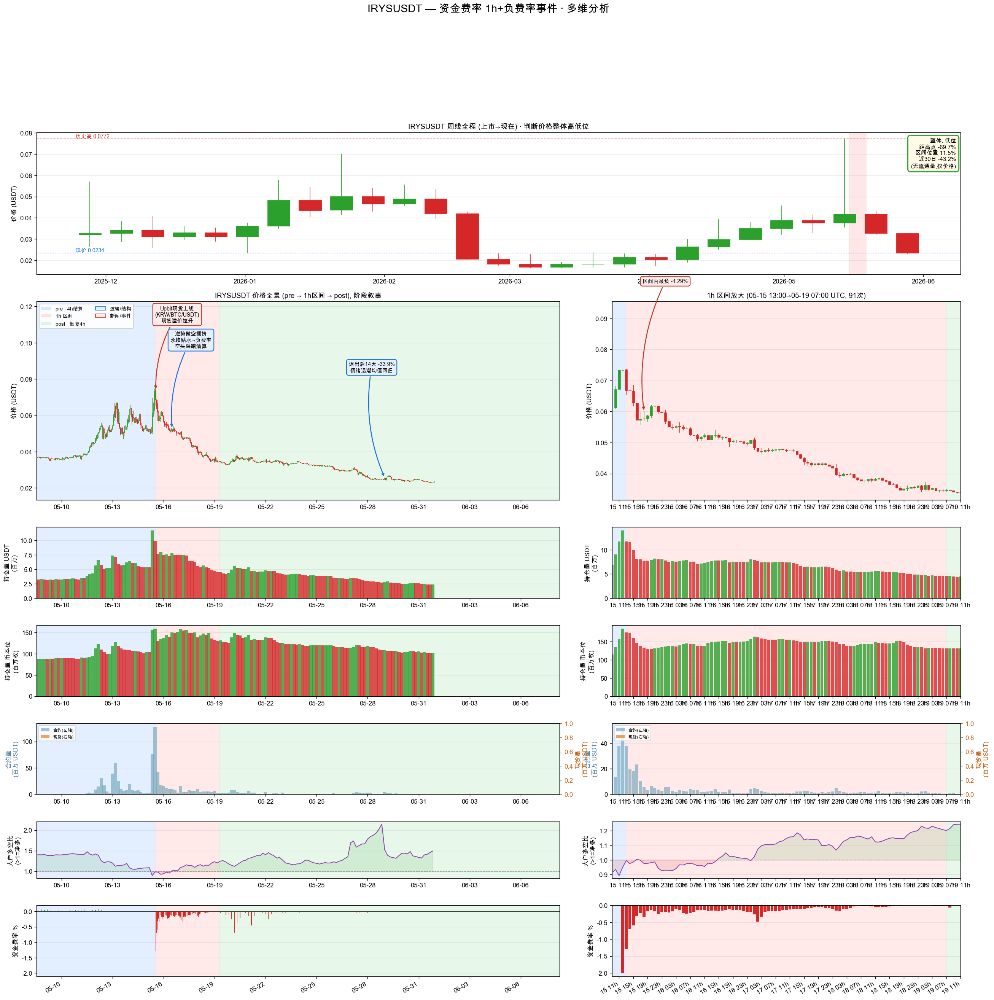
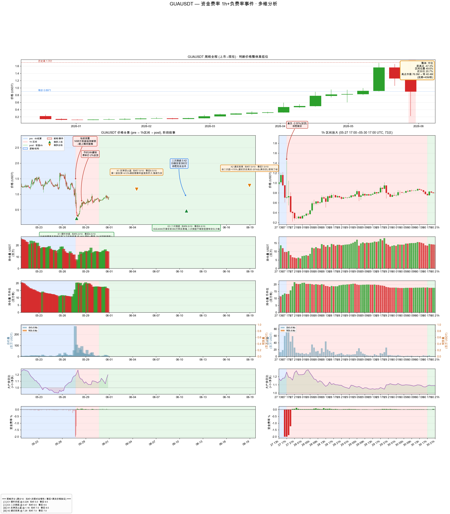
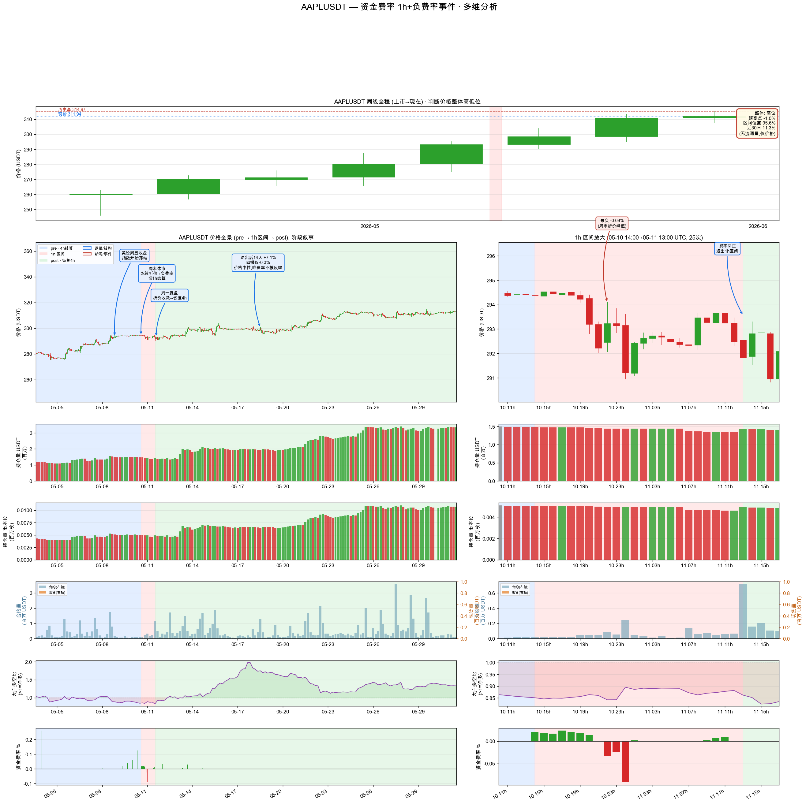
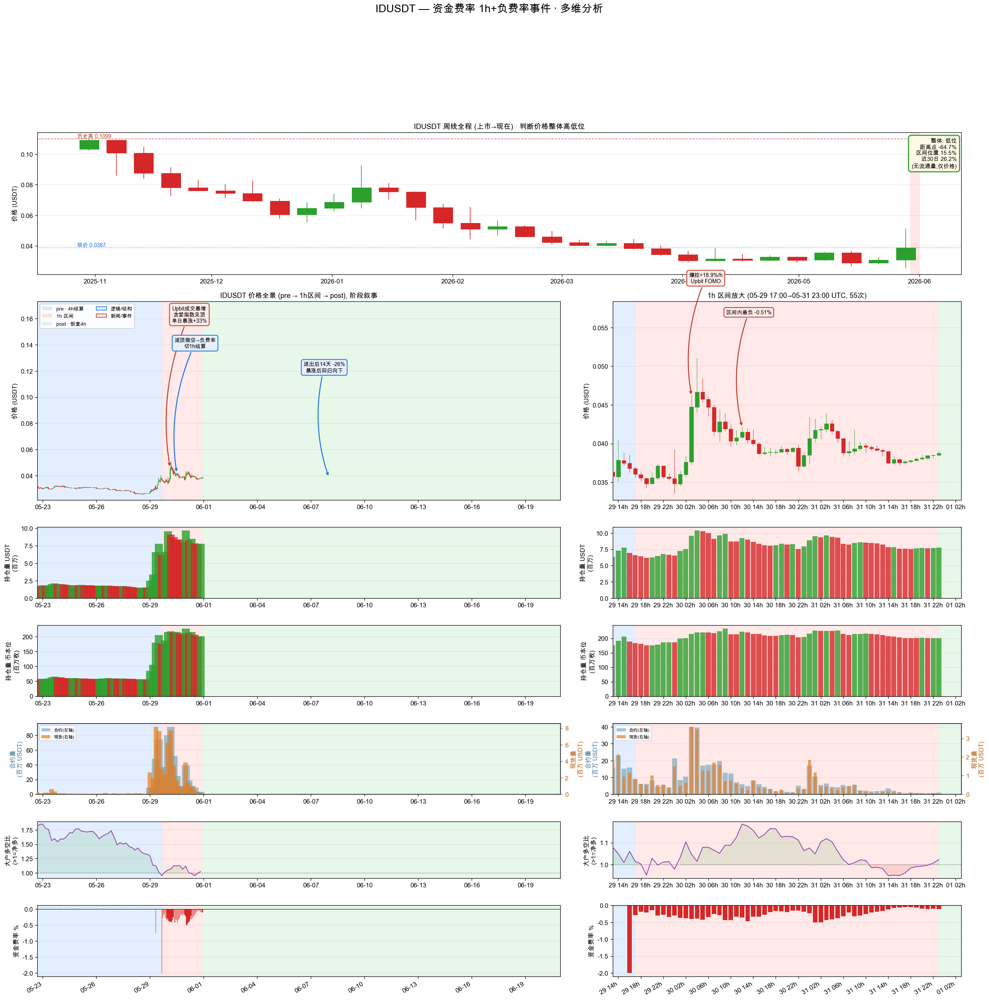
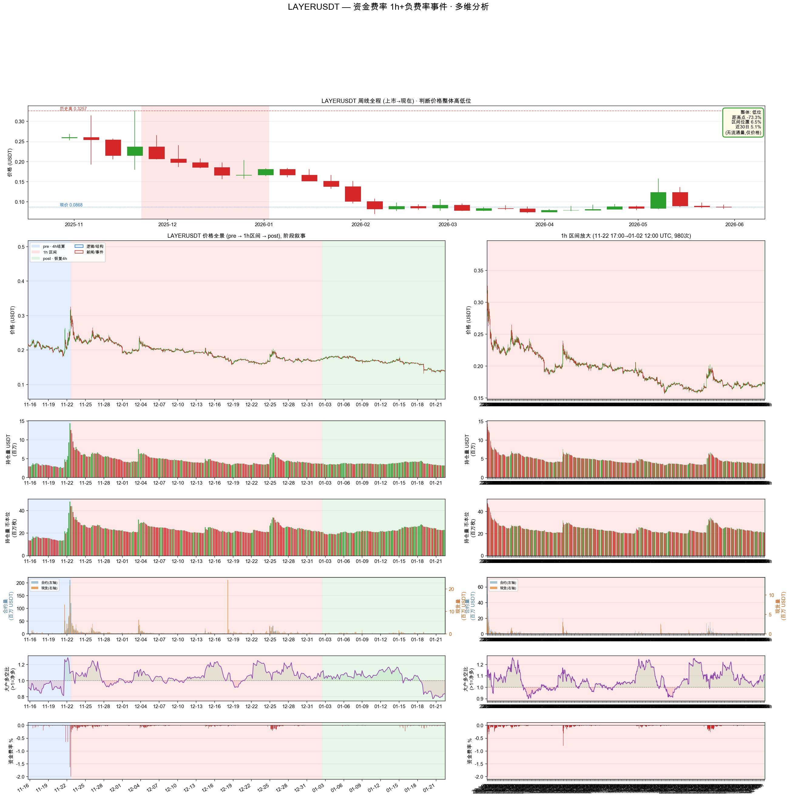
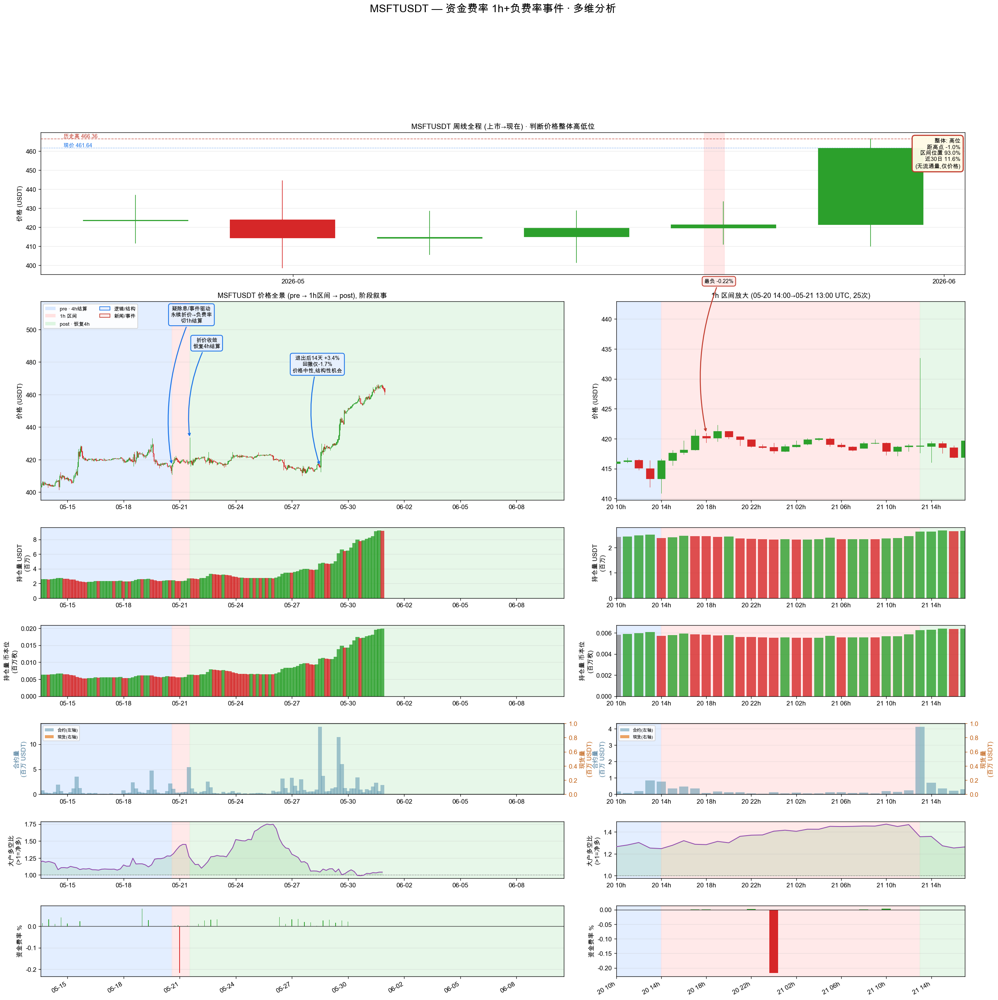

# 币安资金费率极端事件研究

> 扫描全市场永续合约的历史资金费率，找出「结算周期缩短到 1h + 负费率」的极端事件，回答一个问题：**高负费率到底是不是做多机会？**

## 研究问题

币安在行情极端时会把资金费率结算周期从 8h/4h 缩短到 1h。此时如果费率为负，空头在付费给多头，看起来像"做多的补贴"。

很多交易者把「1h 负费率」直接当成抄底信号。但这个假设从来没有被系统性验证过：**样本量多少？后续价格真的涨吗？谁在付钱给谁？**

本项目把这个问题拆成可量化的研究流程。

## 数据与方法

| 项 | 说明 |
|---|---|
| 标的范围 | 币安 USDⓈ-M 全部永续合约（USDT 计价） |
| 数据源 | `data.binance.vision` 月度 dump（历史月份）；`fapi.binance.com` REST（当月 dump 未发布时） |
| 事件定义 | 结算周期 == 1h 且 funding rate < 0，连续区间聚合为一次事件 |
| 样本规模 | 扫描 **772 个币种** |
| 命中结果 | **11 个极端事件** |

流程是模块化的（`collect → metrics → structure → plot → report`），每个环节可单独重跑：

```bash
python run.py collect     # 拉取 funding + OI + 价格数据
python run.py metrics     # 计算事件区间、累计负费率、OI 变化
python run.py structure   # 汇总成研究表
python run.py plot        # 出图和标注
python run.py report      # 生成 Markdown / Word 报告
```

## 核心发现

把 11 个事件逐个拆开看，驱动机制并不相同，归为三类：

| 类型 | 机制 | 命中标的 | 事件退出后 14 天 |
|---|---|---|---|
| **A · 暴涨逼空** | 现货被买爆 → 永续被做空压制 → 负费率 → 空头踩踏 | IRYS, ID, HIVE, ORCA, PROVE, PROMPT, PRL | **跌 21–34%** |
| **B · 暴雷砸盘** | 解锁 / 私钥泄露 → 瞬间崩盘 → 恐慌做空 → 负费率 | GUA, LAYER | **跌 21–23%** |
| **C · 股票永续休市** | 美股休市时指数冻结 → 永续折价 → 结构性负费率 | AAPL, MSFT | **+7.1%, +3.4%** |

**结论：高负费率通常是陷阱，不是做多机会。**

原因在于负费率的成因决定后续走势：

- **A 类（7 个样本）**：负费率是行情过热的伴生品。退出后价格继续下跌 21–34%，靠吃几个百分点的费率完全覆盖不了本金两位数的回撤——典型的"接飞刀"。
- **B 类（2 个样本）**：负费率是崩盘的结果，不是反弹的信号。同样继续跌 21–23%。
- **C 类（2 个样本）**：只有股票永续在休市时段的结构性折价，才是可重复、可解释的低风险机会。

把三类混为一谈、统一当作"抄底信号"，是这类策略最常见的错误。

## 示例图

每个事件生成一张双栏图：左侧全景，右侧放大事件窗口；背景色区分事件前 / 中 / 后，图上只标注客观事实。

| A · 暴涨逼空 | B · 暴雷砸盘 | C · 股票永续休市 |
|---|---|---|
|  |  |  |
|  |  |  |

## 产出

`out/` 目录包含：

- **130 张事件图**（PNG / SVG）——每个事件的价格、资金费率、持仓量叠加图，带客观事件标注
- `metrics.json` —— 每个事件的量化指标（区间、累计负费率、OI 变化、价格位置）
- `dataset.json` —— 原始聚合数据
- `资金费率1h负费率事件分析报告.docx` —— 完整研究报告

制图原则：**图上只写客观事实，不做主观推断**；所有催化剂信息附来源链接。

## 局限与后续

- 事件样本 11 个，属于小样本定性研究，不足以支撑统计显著性结论
- 未做前瞻收益回测（"事件后 N 天涨跌"），这部分在 [volume-spike-research](https://github.com/yu-cc-patrick/volume-spike-research) 里做了方法验证
- 等下一期 binance.vision dump 发布后可增量扫描新事件

## 技术栈

Python 3 · matplotlib · python-docx · binance.vision 数据转储 · Binance fAPI

---

*本项目是研究管线，不是交易信号服务。所有结论基于历史数据，不构成投资建议。*
